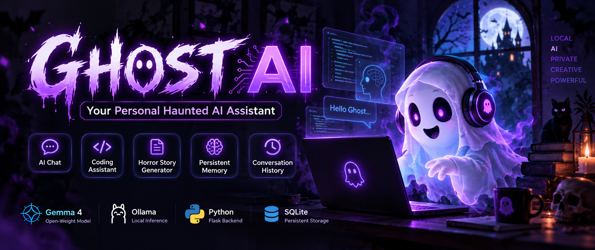

# 👻 Ghost AI — Your Personal Haunted Assistant

<p align="center">
  
</p>

<p align="center">
  <strong>A spooky personal AI assistant powered by Gemma 4 through local Ollama.</strong><br>
  Built for the Hacktoberfest 2026 Week 4 theme: <em>Ghost in the Machine</em>.
</p>

<p align="center">
  <a href="https://github.com/Shantanuu1/ghost-ai">GitHub Repository</a>
  ·
  <a href="https://youtu.be/2gCFJ_GRcxQ">Demo Video</a>
</p>

---

## ✨ About the Project

What if an AI assistant lived inside your computer like a ghost, ready to help whenever you needed it?

**Ghost AI** is a local AI web application built with Flask, SQLite, vanilla JavaScript, and **Gemma 4 E2B running through Ollama**. It combines a haunted, Halloween-inspired experience with practical assistant features—without relying on a paid third-party AI API for inference in its local configuration.

## 🧩 Features

- 💬 **Ghost Chat** — chat with an AI assistant using a spooky personality.
- 🎭 **Three personalities** — Friendly Ghost, Mysterious Ghost, and Nightmare Mode.
- 💻 **Coding assistant** — ask for code explanations, debugging help, error explanations, optimization ideas, and programming guidance. Submitted code is not executed.
- 🩸 **Horror story generator** — create horror stories with the local model.
- 📝 **Text summarizer** — ask Gemma to summarize supplied text.
- 🧠 **Opt-in memories** — save selected information yourself, review it, and delete it.
- 📜 **Conversation history** — revisit saved conversations; rename a conversation by double-clicking its title and delete it with confirmation.
- ⚙️ **Ollama status check** — check whether the local model service is reachable.

> Features listed here should match the current code. If any feature is still unfinished in your version, update this list before publishing.

## 🛠️ Tech Stack

| Technology | Purpose |
|---|---|
| Python 3.10.11 | Backend language |
| Flask | Web server and API routes |
| Gemma 4 E2B | Language model |
| Ollama | Local model runtime |
| HTML, CSS, JavaScript | Frontend |
| SQLite | Persistent conversations and saved memories |
| Git and GitHub | Version control and source hosting |

## 🏗️ Architecture

```text
Browser (HTML/CSS/JavaScript)
            |
            v
       Flask backend
       /     |      \
      v      v       v
 Chat routes  SQLite  AI service
              |         |
              v         v
       Conversations   Ollama
       and memories      |
                         v
                    gemma4:e2b
```

The main modules are:

- `app.py` — application routes and request validation.
- `ai_service.py` — Ollama requests, personality prompts, and model status.
- `database.py` — SQLite persistence using parameterized queries.
- `config.py` — application configuration and environment settings.
- `templates/` and `static/` — the web interface.

The app includes up to 20 explicitly saved memories in the system prompt and sends the latest 10 conversation turns as context.

## 🚀 Run Locally on Windows

### Prerequisites

1. Install Python 3.10 or a compatible Python version.
2. Install [Ollama](https://ollama.com/).
3. Make sure the model is available:

   ```powershell
   ollama list
   ```

   The list should include `gemma4:e2b`. If it is not installed, download it with:

   ```powershell
   ollama pull gemma4:e2b
   ```

### Installation

Open PowerShell in the project directory and run:

```powershell
python -m venv .venv
.\.venv\Scripts\Activate.ps1
python -m pip install -r requirements.txt
Copy-Item .env.example .env
python app.py
```

If `.env` already exists, do not overwrite it; check that `OLLAMA_MODEL` is set to `gemma4:e2b` using the variable name expected by the application.

Then open:

**http://127.0.0.1:5000**

### Run the tests

The test suite mocks Ollama, so it should not need to load the model:

```powershell
python -m unittest tests.test_app
```

## 🔐 Privacy and Local Processing

In the local setup, prompts are sent to the Ollama service at `127.0.0.1` on your computer. The application does not need a third-party AI inference API for its normal local workflow.

Conversation and memory data are stored in the local SQLite database at `instance/ghost.db` and should remain excluded from version control.

**Important:** This privacy description applies to the local configuration. If you deploy the application or Ollama on another machine or server, prompts and stored data may be sent to or held on that host. Do not expose the local Ollama API directly to the public internet.

## ⚠️ Limitations

- Responses are not streamed.
- Stopping a response in the browser discards it from the interface; the model may continue generating.
- Memory retrieval uses the newest saved memories rather than semantic search.
- The app is designed for a single user and does not include login.
- Performance depends on the computer's available memory and processing power.
- Check Gemma's license and usage terms. Open model weights do not automatically mean every part of a model is fully open source.

## 🔮 Future Improvements

- Stream responses as they are generated.
- Add semantic memory search.
- Add conversation export and import.
- Improve test coverage and performance.
- Add verified application screenshots.

## 🎬 Demo

Watch the project demo: **https://youtu.be/2gCFJ_GRcxQ**

## 🧑‍💻 Source Code

Repository: **https://github.com/Shantanuu1/ghost-ai**

## 🏷️ Hacktoberfest

This project was created for the **Hacktoberfest 2026 Week 4: “Ghost in the Machine”** challenge.

DEV Community tags: `#devchallenge` `#hf26challenge`

---

Made with Python, local AI, and a little ghostly imagination. 👻
